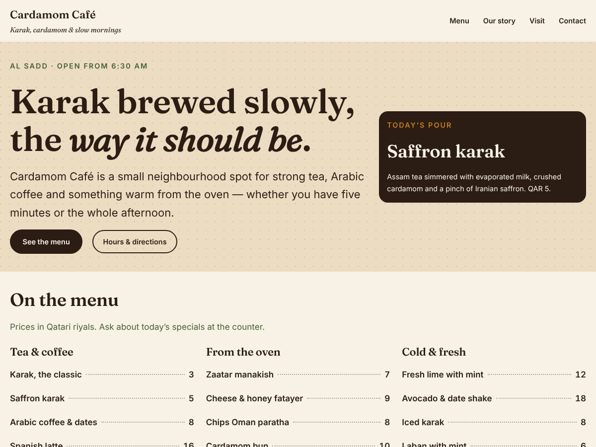

# Cardamom Café — block theme

A warm, typographic block theme for a small neighbourhood café in Doha. *(Cardamom Café is a
fictional brand made for this portfolio.)*



## What's inside

```
theme.json            the whole design: palette, fonts, fluid type scale, spacing, element and block styles
style.css             theme header + the few rules theme.json can't express (hero texture, menu leaders)
functions.php         loads style.css in the editor too; registers the pattern category
templates/            front-page, page, single, index (blog), 404
parts/                header (site title, tagline, navigation), footer
patterns/             hero, menu-highlights, story, visit-cta — written in PHP so text is translatable
assets/fonts/         Fraunces and Inter, self-hosted (SIL OFL, see OFL.txt)
```

## Decisions worth noting

- **Design lives in `theme.json`.** Colours, type and spacing are presets, so the owner can restyle
  the site from the Site Editor's Styles panel without touching code.
- **Fonts are self-hosted** through `fontFace` in `theme.json` — no request to Google, faster and
  privacy-friendly.
- **Fluid type**: headings scale between phone and desktop sizes with `clamp()`, no breakpoints.
- **The menu is data.** `patterns/menu-highlights.php` holds the dishes in one array and renders them
  as blocks, with a dotted leader between dish and price; after inserting, every line is editable.
- **Every string is translatable** (`cardamom-cafe` text domain) and every output is escaped.
- **Accessible by default**: real headings in order, visible keyboard focus, colour pairs that pass
  WCAG AA (espresso on cream is 14.5:1, cardamom on cream 6.2:1).

## Install

Copy this folder into `wp-content/themes/` and activate **Cardamom Café** under
**Appearance → Themes**. Requires WordPress 6.6+ and PHP 7.4+; tested on 7.1.3.
